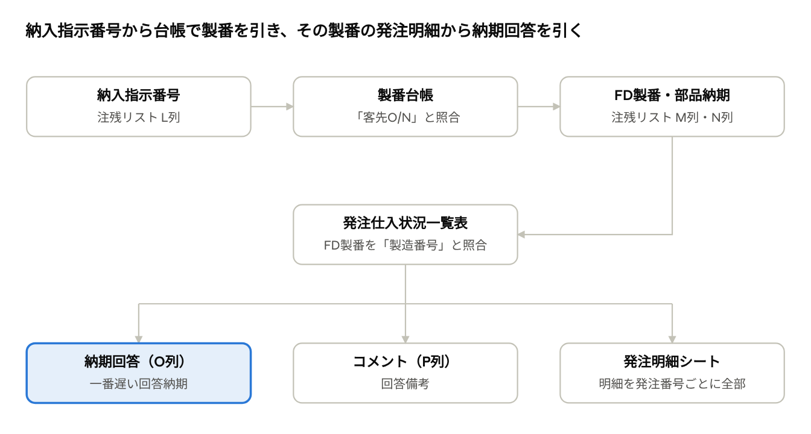

# 製番転記ツール 操作マニュアル

作成日: 2026-10-29 · 作成者: 熊谷 奈保

## 概要

製番転記ツールは、注残リストに FD製番・部品納期・納期回答・コメントを自動で入れ、発注番号ごとの「発注明細」シートを作るツールです。製番転記.bat をダブルクリックし、画面の「実行」を押すだけで使えます。

ブラウザ版もあります。製番転記（ブラウザ版）.url をダブルクリックすると https://ai-coaching2.n-kumagaya.workers.dev/ が開きます。ファイルはブラウザの中だけで処理し、インターネットには送りません。上書き保存と台帳の記憶は Chrome / Edge で使えます。このマニュアルは .bat で開く Windows 版の説明です。

| 注残リストの列 | 入る内容 | 元データ |
| --- | --- | --- |
| M列 FD製番 | 納入指示番号に対応する製番 | 製番台帳の「製番」（台帳の「項目内容(客先O/N)」と納入指示番号を照合） |
| N列 部品納期 | その製番の部品納期 | 製番台帳の「部品納期」 |
| O列 納期回答 | その製番の発注明細で一番遅い回答納期 | 発注仕入状況一覧表の「回答納期」 |
| P列 コメント | その製番の回答備考 | 発注仕入状況一覧表の「回答備考」 |
| 発注明細シート | 注残の行ごとに、その製番の発注明細を全部 | 発注仕入状況一覧表 |

照合は2段階です。製番台帳で製番が分からない行は、納期回答・コメント・発注明細も入りません。

列は見出しの名前で探すため、列の位置が変わっても動きます。製番台帳と発注仕入状況一覧表は読むだけで、書き換えません。

## 準備

使う前に、次の4種類のファイルがそろっていることを確認します。PCに Excel が入っていて、社内ネットワーク（共有フォルダ）につながっている必要があります。

| ファイル | 置き場所 | 注意点 |
| --- | --- | --- |
| 製番転記.bat、製番転記.ps1 | 同じフォルダ（例: デスクトップの ai-coaching2-\\製番転記\_納期回答） | 2つは必ず同じフォルダに置く |
| 注残リスト.xlsx | 初期値は ai-coaching2-\\製番転記\_納期回答\\データ | 見出し「納入指示番号」「FD製番」「部品納期」「納期回答」「コメント」が必要 |
| 発注仕入状況一覧表\_〜.xlsx | 注残リストと同じフォルダ | 一番新しいものが自動で選ばれる |
| 製番台帳 | \\\\192.168.11.200\\Share\\12.製番台帳\\ | 初期値は43期の 4374（AMD単品 富士宮）と 4366（AMD単品 土岐） |

発注仕入状況一覧表は、日付入りのファイル名のまま置いて構いません。古いものを残していても、更新日時が一番新しいものが使われます。

## 画面の説明

製番転記.bat をダブルクリックすると、「注残リスト 製番転記」の画面が開きます。前回使った注残リストと製番台帳が、最初から入った状態で開きます。

| 画面の項目 | 役割 |
| --- | --- |
| 注残リスト＋「参照...」 | 書き込む注残リストを選ぶ |
| 発注仕入状況一覧表＋「参照...」 | 納期回答・コメント・発注明細シートの元データ。空欄にすると、この3つは作らない |
| 製番台帳の一覧＋「追加...」「削除」 | FD製番・部品納期の元データ。一覧にエクスプローラーからファイルをドラッグしても追加できる |
| 「すでにFD製番・部品納期が入っている行も上書きする」 | オフ（初期）：入力済みの FD製番・部品納期はそのまま残す。オン：台帳の内容で入れ直す。納期回答とコメントは、このチェックに関係なく毎回最新に入れ直す |
| 「実行」 | 転記を始める |
| 下の大きな欄 | 実行中の進み具合と、終わったあとの結果（件数、納期回答が変わった行など） |

ファイル選択画面では、Ctrl を押しながらクリックすると、製番台帳を一度に複数選べます。

## 実行手順

1回の実行は、台帳6つで約3〜4分かかります。毎回この順番で操作します。

1. 注残リストを用意する。M〜P列に「FD製番」「部品納期」「納期回答」「コメント」の見出しがあることを確かめる。
2. 最新の発注仕入状況一覧表を、注残リストと同じフォルダに保存する。
3. 注残リストを Excel で開いていれば閉じる。開いたままだと実行できない。
4. 製番転記.bat をダブルクリックする。
5. 画面の注残リスト、発注仕入状況一覧表、製番台帳の一覧を確認する。必要なら「参照...」「追加...」で変える。
6. 「実行」を押す。下の欄に進み具合が出る。
7. 「完了しました。」が出たら、下の欄の結果を確認して、画面を閉じる。
8. 注残リストを開き、色の付いたセルと発注明細シートを確認する。

実行するたびに、元の注残リストが「バックアップ」フォルダにコピーされてから保存されます。結果がおかしいときは、そこから戻せます。

## 結果の見方

色を見れば、前回から納期回答がどう変わったかが分かります。色は実行のたびに付け直すので、直前の実行との違いだけが出ます。

| 見た目 | 意味 | 対象の列 |
| --- | --- | --- |
| 水色塗り・白字 | 空欄だった納期回答が新しく入った（初回の取り込み） | O列 |
| 赤塗り・白字 | 前回から納期回答が変わった | O列 |
| 黄色塗り・赤太字 | 製番が2つ以上ある（「/」でつないで入る）。ほかの色より優先 | M・N・O列 |
| 塗りなし・黒字 | 前回から変わっていない | M・N・O・P列 |

**セルのメモ**　O列のセルに赤い三角があるときは、マウスを当てるとメモが読めます。

- 変わった行：「前回 2026-11-05 → 今回 2026-11-19 +14日遅れ」のように、前回の日付と差
- 新しく入った行：「納期回答が新しく入りました」
- 「※回答納期が未入力の発注明細があります」：入荷が残っているのに回答納期が空の明細がある。実際の納期はもっと遅くなるかもしれない
- 「※FD製番が複数あります」：黄色の行。新規・変更だった場合もメモで分かる

**納期回答（O列）の決まり方**

- FD製番と同じ製造番号の発注明細のうち、一番遅い回答納期を入れる。
- FSH・FZH・SM など、無視する発注先の明細は使わない（「設定の変更」参照）。
- 回答が無くなった行は、前回このツールが入れた値なら消す。自分で入力した値は残す。

**コメント（P列）の決まり方**

- 一番遅い回答納期の明細の回答備考を先頭に、入荷が残っていて回答納期が空の明細の回答備考を続ける（「 / 」でつなぐ）。
- 「〃」は、すぐ上の行（同じ発注先）の回答備考に置き換える。
- 毎回入れ直すので、P列に自分で書いた内容や色は上書きされる。自分用のメモは別の列に書く。

## 発注明細シート

注残リストの「発注明細」シートには、注残の行ごとに、そのFD製番の発注明細が全部（完納・未発注も含めて）並びます。納期回答の日付がどの明細から来たかを確かめるときに使います。

| 列 | 内容 |
| --- | --- |
| 注残の行・事業所名・納入指示番号・品名・FD製番・納期回答 | 注残リスト側の情報（「注残の行」は元のシートの行番号） |
| 発注番号・発注先番号・発注先名称・品名規格・型式材質 | 発注明細の情報 |
| 発注数・仕入数・仕入残・仕入状況 | 数量と入荷の状況 |
| 発注日・部品納期・回答納期・回答備考 | 日付と回答（「〃」は置き換え済み） |
| 区分 | 「★納期回答の元」：O列の納期回答の元になった明細。「対象外の発注先」：無視する発注先の明細 |

- 見出しにフィルタが付いているので、「区分」で★だけ表示したり、「仕入残」で絞り込んだりできる。
- 同じFD製番が注残の複数の行にある場合は、行ごとに同じ明細が繰り返し出る。
- シートは実行のたびに作り直す。このシートに書き込んだ内容や色は、次の実行で消える。
- 元のシート（DBC\_DeliveryManagement\_Supplier）には手を加えない。保存するときも、元のシートを開いた状態にする。

## 自動で作られるファイル

実行すると、次のファイルが自動で作られます。納期回答履歴.csv と製番転記\_設定.json は消さないでください。

| ファイル | 場所 | 内容 |
| --- | --- | --- |
| 注残リスト\_日付\_時刻.xlsx | 「バックアップ」フォルダ | 書き込む前の注残リスト。実行のたびに1つ増えるので、古いものは適宜削除してよい |
| 納期回答履歴.csv | 注残リストと同じフォルダ | 前回入れた納期回答と回答備考（納入指示番号ごと）。次の実行で「変わったか」を比べるのに使う。消すと、次の実行で全部が新規扱いになる |
| 納期回答変更\_日付\_時刻.csv | 「納期回答変更」フォルダ | その回に変わった行・新しく入った行の一覧（区分、品名、前回と今回の日付、何日遅れたか）。Excelで開ける。過去の変化はここで確認する |
| 製番転記\_設定.json | 製番転記.ps1 と同じフォルダ | 画面で選んだ注残リストと製番台帳の一覧。次に起動したときに読み込む |

変更一覧のCSVは、変わった行か新しく入った行があるときだけ作られます。

## 設定の変更

製番台帳の一覧は画面で変えれば自動で保存されます。無視する発注先は、製番転記.ps1 の1行を直して変えます。

**製番台帳を追加・削除する**

1. 画面の「追加...」を押して台帳を選ぶ（エクスプローラーから一覧へドラッグしてもよい）。
2. 外したい台帳は一覧で選んで「削除」を押す。
3. 一覧は自動で保存され、次回からも同じ台帳が入った状態で開く。

台帳は「製番」と「項目内容(客先O/N)」の見出しがある形式なら読めます。モジュール、EGB、HG などの量産系の台帳は「客先O/N」に生産月が書かれているため、追加しても製番は入りません。

**無視する発注先を変える**

1. 製番転記.ps1 をメモ帳で開く（右クリック →「プログラムから開く」→ メモ帳）。
2. 20行目付近の次の行を探す。 `$IgnoreSuppliers = @('FSH', 'FZH', 'FZH2', 'NK', 'SFD', 'SFH', 'SFZ', 'SM', 'SMF', 'SPH', 'SPM', 'SPP', 'STK')`
3. 発注先番号を `'番号'` の形で、カンマ区切りで追加・削除する。
4. 文字コードを変えずに上書き保存する（メモ帳なら「UTF-8 (BOM 付き)」のまま）。

書き方を間違えると起動しなくなります。直す前に製番転記.ps1 をコピーしておくと安心です。

## 困ったとき

エラーが出たときは、注残リストは保存されず元のままです。原因を直して、もう一度「実行」を押してください。

| 症状 | 原因 | 対処 |
| --- | --- | --- |
| 「注残リストが他で開かれています」 | 注残リストを Excel で開いている | Excel で閉じてから実行する |
| 「…の見出しが見つかりません」 | 注残リストまたは発注仕入状況一覧表の見出しの名前が違う | メッセージに出た見出しがあるか確かめる（空白の違いは問題ない） |
| 「※ファイルが見つかりません。スキップします」 | 製番台帳の場所が変わった、または共有フォルダにつながっていない | 共有フォルダを開けるか確かめ、一覧から削除して追加し直す |
| 製番が入らない行が多い | その納入指示番号が、一覧の台帳に無い。量産系の台帳には納入指示番号が書かれていない | AMD単品など、必要な期の台帳を追加する |
| 納期回答が空欄のまま | 発注明細に回答納期がまだ無い、または無視する発注先の回答しかない | 発注明細シートでその製番の明細を確かめる |
| 実行に時間がかかる | 製番台帳をネットワーク越しに1つずつ開いている | 不要な台帳を一覧から削除する。台帳6つで約3〜4分が目安 |
| P列や発注明細シートに書いた内容が消えた | この2つは実行のたびにツールが入れ直す | 自分用のメモは別の列に書く |
| 結果を実行前に戻したい | ― | 「バックアップ」フォルダの一番新しいファイルを「注残リスト.xlsx」の名前で元の場所に戻す |

台帳の入力ミス（例: 「4374397」が「43.74397」、「-001」が「-01」）は、そのまま転記されるか、照合できません。おかしな製番を見つけたら、台帳の方を直してください。
